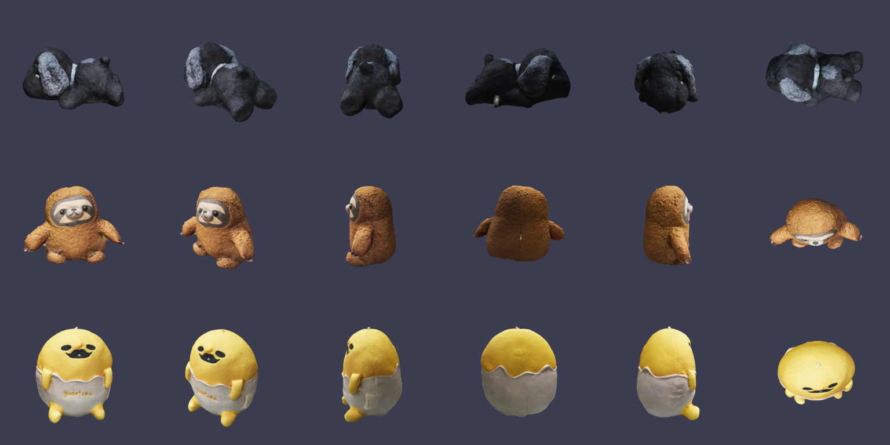
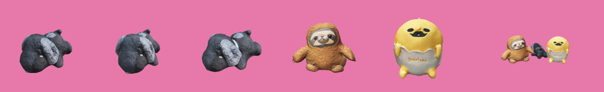

# 毛絨消消樂：目前進度報告

目標：做一款玩法和風格像 Candy Crush 的三消遊戲，畫面裡的方塊和圖案全部用這三個 AR 掃描的毛絨玩具：
**皮蛋**（黑色小狗）、**薯餅**（樹懶）、**蛋黃哥**（蛋）。

這份報告整理到目前為止的進度，方便在新的對話裡接著做。

---

## 0. 目前狀態（2026-11-22）

遊戲可以玩了，網址：**https://bonk520.github.io/shubing/** （GitHub Pages，每次 push 自動更新）。共 **100 關**。

- **本地玩**：在專案根目錄跑 `python -m http.server 8000`，瀏覽器打開 `http://localhost:8000`。
- **方塊 7 種**（每關用 4–6 種）：
  - 皮蛋、薯餅、蛋黃哥：Object Capture 掃描，選到會轉圈
  - 火腿（存錢豬）（2026-11 取代龍龍）、貓咪老師、彈跳豬（Moo Deng）、史努比：主人拍的照片去背，選到會彈跳
- **計分和星星（照 Candy Crush）**：三連 60、四連 120、L/T 200、五連 200、2×2 正方形 120（正方形碰到一排一起消再 +60），被特殊方塊炸到每顆 60，連鎖倍率 ×1、×2、×3…，果凍每層 1,000。
  每一關都是目標關（收集指定的玩具、或清掉果凍），目標一達成就結束，剩下的每一步 +3,000 並變成超級糖果（條紋，約 1/4 是包裝）引爆（薯餅狂歡時間）。
  星星門檻是漂亮的 1 : 2 : 3，越後面越難，但三星「隨便玩也常常拿得到」（2026-11 依玩家回饋調簡單，模擬玩家校準過）：
  第 1 關認真玩約 95% 三星、隨便玩約 74%；第 2–11 關隨便玩約 50–67%；第 15 關認真玩約 89%、隨便玩約 32%；
  2026-11 機關重編排之後全部 100 關重新調過（步數 15–47）：第 1–30 關隨便玩約 69–100% 過關、31–80% 三星；第 31–60 關約 66–96% 過關、26–58% 三星；第 61–100 關約 65–88% 過關、26–54% 三星；認真玩 89–100% 過關。`python tests/run_tests.py --sim --games 400`：100 關全部達到平衡目標。
- **關卡（`js/levels.js`）**：1–15 關照順序教玩法（收集 → 第 2 關條紋、第 3 關飛天玩偶、第 4 關包裝 → 造型盤面 → 果凍 → 綜合）。
  16–100 關每五關一章，每關一個新的造型盤面，收集和果凍輪流，章末那關最難，下一章開頭先放鬆一點：
  彎彎小路、貓咪老師的臉、史努比的狗屋、城堡、皮蛋的腳印（20）｜薯餅的大樹、左右兩座島、點點、杯子、大圓環（25）｜
  皮蛋的骨頭、愛心、包裝糖果、叉叉、王冠（30）｜
  **海邊**：小魚、帆船、船錨、海浪、燈塔（35）｜**甜點**：杯子蛋糕、冰淇淋、棒棒糖、生日蛋糕、巧克力盒（40）｜
  **天空**：下雨的雲、彎月、星星、火箭、土星（45）｜**花園**：花、香菇、鬱金香、仙人掌、彩虹（50）｜
  **玩具屋**：小熊、小火車、積木、風箏、彈跳豬的臉（55）｜**大冒險**：寶藏鑰匙、雙塔、梯子、兩顆愛心、冠軍獎盃（60）｜
  **雪地**：雪人、手套、雪花、冰屋、聖誕樹（65）｜**遊樂園**：氣球、摩天輪、門票、旋轉木馬、雲霄飛車（70）｜
  **森林**：樹葉、橡實、貓頭鷹、小木屋、狐狸（75）｜**音樂會**：音符、吉他、小鼓、鋼琴、麥克風（80）｜
  **海底**：章魚、貝殼、水母、鯨魚、寶箱（85）｜**宇宙**：幽浮、彗星、外星人、星球、銀河漩渦（90）｜
  **城市**：公寓、公車、雨傘、咖啡杯、城市高塔（95）｜**終極冒險**：寶石、皇冠、城堡大門、金牌、煙火（100，最後一關）。
  平衡目標在 `tests/sim.js` 的 `targetsFor`（casual 和 decent 都有三星目標；難度 t 第 1–15 關 0 → 0.85，之後每章 0.55 起、每關 +0.07）。
  `python tests/tune_levels.py` 自動找步數、星星門檻和種子（種子挑「第一次玩看到的盤面」最像平常盤面的那個；
  `--keep-moves-upto 30` 讓舊關卡步數不會變少），再用 `python tests/run_tests.py --sim` 確認每一關都達標（100 關全部達標）。
  果凍不要放在只能直的消的格子（最上排單獨的格子、尖角、洞旁邊的邊角、只有兩格寬的地方、獎盃的把手），那種格子機器人幾十步都消不掉。
  （跑測試要 Python 的 playwright；這台雲端機器上是 `pip install playwright==1.63.0`，再設 `PLAYWRIGHT_BROWSERS_PATH=/opt/pw-browsers`。）
- **盤面機關（2026-11，像 Candy Crush 的經典障礙，可以在任何一關自由組合）**：
  - **救出龍龍**（原本恐龍玩偶的實拍照片，坐在綠點點的蛋殼裡、會東張西望）：把牠下面的玩偶消掉，牠就往下掉；
    走到綠色箭頭出口：蛋殼搖一搖 →「喀」破殼、跳「破殼！」→ 變大隻 → 往上飛，再沿弧線飛到上面的目標圖示。不能配對、不會被炸掉。
  - **鐵籠子**：被關的玩偶不能交換、不會掉，也擋住上面掉下來的東西；同色配對穿過或特效打到就裂成兩半飛走，玩偶留著。
  - **多層糖霜（1–3 層）**：一層一層疊的小蛋糕（香草 / 草莓 / 芋頭），旁邊配對或特效敲掉一層、噴碎屑。
  - **巧克力**：一步沒清到任何巧克力，就有一塊往旁邊長、把玩偶吃掉。
  - **甘草漩渦糖**：會掉、能交換、不能配對；旁邊配對或特效清掉；條紋光束會被它擋住。
  - **傳送門**：一欄下面掉出去，從另一欄上面（同顏色的門）掉進來。
  - 新目標：救出幾隻龍龍、清光糖霜 / 巧克力 / 籠子、王關好幾個目標一起。
  - **關卡輪流出現**：第一次出現（跳教學小卡：圖示 + 一句話，點一下開始）冰果凍 7、龍龍 10、鐵籠子 12、糖霜 16、
    巧克力 22、甘草 26、傳送門 31；第 31 關以後每章五關：救龍龍（隔章換傳送門 + 甘草收集）→ 冰果凍 + 籠子 / 傳送門 →
    清糖霜 + 籠子（隔章換巧克力 + 收集）→ 冰果凍 + 糖霜 / 傳送門 → 章末王關。盤面造型和章節都沒變。
- **2×2 正方形 → 飛天玩偶**（像 Candy Crush 的瑞典魚，玩法一樣；引擎裡的名字還是 `'fish'`）：四顆一樣的排成田字形會消掉，
  並在那一格變出「飛天玩偶」特殊方塊：原本的實拍玩偶照片不變，背後長出一對半透明、微微發光的白色小天使翅膀（會一直拍），
  玩偶在糖果上輕輕上下懸浮，底座外面一圈金色 / 淺藍的星光環，一眼看得出是追蹤道具。
  正方形碰到一排三連（P 形）也是飛天玩偶；碰到四連 / L / T / 五連的話，照那一排變條紋 / 包裝 / 彩色炸彈。
  被消到時，長翅膀的玩偶放大飛離盤面，先往上劃一道弧線（身後拖著星塵和羽毛），再俯衝撞進目標格，炸出一圈光波：
  先找有果凍的格子，再找收集目標還差的毛絨，都沒有就隨便一顆。
  組合技：兩隻 → 三隻飛出去；飛天玩偶 + 條紋 / 包裝 → 帶著它飛過去，在目標那裡發動；彩色炸彈 + 飛天玩偶 → 那種毛絨全部長翅膀一起飛。
  第 3 關的提示會教「四顆排成田字，會變出長翅膀的飛天玩偶！」。補位、開局盤面和洗牌都會避開正方形，跟避開三連一樣。
- **沒步可走**：整個盤面都沒辦法消的時候，跳出「洗牌！」（沒有可以消的了～蛋黃哥幫你重新洗一洗），所有方塊轉一圈飛到新位置（洗完至少有 2 組可以消）。
- **畫面（2026-11 第二次調整：高對比）**：格子裡面是沉穩的半透明深藍紫玻璃（`rgba(38,46,95,.72)` / `rgba(48,58,115,.72)` 交錯 + 細細的淡色內格線，
  主題在 `renderer.js` 的 `BOARD_THEMES`；夾娃娃機台主題的裡面也改成深梅紫），外框維持奶油粉色。淺色的盤面會讓淺色玩偶、果凍糊在一起，所以改回深色。
  每隻玩偶一個完全不撞色的高飽和底座色（`js/pieces.js`：紫、橘、金黃、綠、寶藍、桃紅、正紅），底座稍微放大（半徑 0.485 格），
  玩偶照片照不透明部分算、約一格的 71%（連透明邊約 78%），底座的顏色在玩偶周圍完整露出一圈；底座形狀只有微幅差異。
  果凍改成透亮的冰藍水晶（單層：青藍色半透明 + 細亮冰邊；雙層：深冰藍 + 兩層高光 + 斜斜的結晶反光），敲掉一層時噴出碎冰；
  目標圖示也是冰藍色。發光天使光環的光暈收小了。
  實拍玩偶照片完全不改，外面一圈約 1.5px 的柔和白色貼紙描邊 + 底部接觸影；糖果底座有壓克力的底部厚邊和頂部弧形高光。
  條紋：糖果裡一道白光沿著方向一直掃過 + 會呼吸的霓虹光暈 + 箭頭外面兩顆往外跑的小光點（一眼看出橫消 / 直消）；
  包裝：明顯的呼吸縮放 + 一明一暗的金色光環 + 繞著轉的小星星；彩色炸彈：呼吸縮放 + 會轉的彩虹光環。
  背景加了極淡的漂浮光點（`main.js` 的 `tickMotes`，每秒只移 10 次，比 CSS 動畫省電；有對話框時停住）。
  星星 / 閃粉粒子用一般疊色（在任何主題的盤面上都看得到）。
- **掉落和連消（Candy Crush 的流暢感，2026-11）**：
  - 引擎（`js/engine.js`）：洞會擋住方塊（不再穿過去）；新方塊只從每一欄最上面那格進來。正上方是洞、補不到的格子，
    由左上 / 右上停住的方塊**斜向滑落**補進去（事件裡帶 `path`，畫面沿著折線掉）；真的到不了的格子才直接長出新方塊。
  - 補位的顏色在全部落定之後才決定（由下往上），`cascadeBias` 0.18：約 18% 的新方塊照旁邊已經有的顏色，很容易一路連消；
    `antiCascade` 預設 0（不再刻意避開連消）。糖果狂歡時不加這個偏向（獎勵階段要收得起來）。
  - 顏色數：寬闊的大盤面 5 色、窄的 / 彎的 4 色（`js/levels.js`）。連消多很多，所以收集數量 ×2、第 16 關以後的果凍都是兩層，
    步數、種子和星星門檻全部用 `tests/tune_levels.py --min-moves 15` 重新調過（步數至少 15）。
  - 動畫（`js/renderer.js`）：消除閃光後約 100ms 上面就開始往下灌（`POP_LEAD`），同一組「啵啵啵」間隔 26ms；
    掉落是重力加速度（`G_FALL` 0.00009 格/ms²），同一欄只錯開 30ms；落地壓扁回彈 130ms 內做完；下一輪連鎖在落地後 80ms 就爆。
    被波及的特殊方塊一個接一個、每隔 70ms 接力引爆（`CHAIN_MS`）。
  - 特殊方塊兩兩合體（直接交換兩個特殊方塊）：先吸在一起、放大、震動（條紋 + 包裝放大到 3 倍）再發動。
    條紋 + 條紋 = 十字；條紋 + 包裝 = 3 排 + 3 欄；包裝 + 包裝 = 5×5，補位後再炸一次 5×5；彩色球 + 普通 = 那一色全消；
    彩色球 + 條紋 / 包裝 = 那一色全部變成條紋 / 包裝再依序引爆；彩色球 + 彩色球 = 全盤一層；
    飛天玩偶 + 條紋 / 包裝 = 飛出 3 隻，各自帶著條紋 / 包裝俯衝到目標再引爆。
- **玩偶衣櫃（三星外觀獎勵，`js/cosmetics.js`）**：地圖右下角紫色的「衣櫃」大按鈕（上面顯示造型幣數量，有寶箱可以開時亮紅點），
  過關卡片下面也有「玩偶衣櫃」入口。衣櫃上面是即時預覽的小盤面（3 × 4，含一顆條紋和一隻飛天玩偶，可以「試試消除特效」），
  下面四個分類：**頭飾配件**（不戴、粉紅蝴蝶結、害羞紅腮紅、迷你金皇冠、酷炫黑墨鏡、小廚師帽、發光天使光環，SVG 畫的，
  疊在實拍照片上面，照片不改；戴上之後盤面上所有玩偶都會戴）、**消除特效**（星光棉花、櫻花花瓣雨、彩虹愛心泡泡、奢華金粉亮片）、
  **方塊底座**（果凍、酥脆餅乾、透明扭蛋球、花瓣）、**棋盤主題**（夢幻馬卡龍、粉紅夾娃娃機台、野餐草莓格紋、深邃夢幻星空）。
  沒解鎖的可以先點一下「試穿」看效果，旁邊寫怎麼解鎖（幾枚造型幣兌換 / 星星總數幾顆 / 哪個寶箱）。
  - **三星造型幣**：每一關第一次拿到三星送 1 枚（過關卡上金幣翻進來、整張卡閃金光）。造型幣是照存檔裡每關的星星算的，
    所以以前拿過的三星也算、換手機登入也還在；兌換過的外觀、開過的寶箱存在這台裝置（每個帳號一份，key = 存檔 key + `.closet`），
    換了裝置要重新兌換（造型幣會退回來）。Firestore 規則不用改。
  - **三星豪華寶箱**：星星總數 3、9、15、24、36、54、80、110、145、180、220、260、300 各一個，開出稀有主題 / 限定全套（36 顆星的「星空貴族全套」= 星空主題 + 金粉亮片）+ 造型幣。
  - 開發用開關：`js/cosmetics.js` 最上面的 `DEBUG_UNLOCK_ALL_COSMETICS`，改成 `true` 全部解鎖可以先預覽，正式玩改回 `false`。
  - 配件戴的位置：`TOY_FACE`（每隻玩偶的臉在照片裡的位置）、`ACCESSORY_PLACE`（每種配件的基本位置）、
    `ACCESSORY_TUNING`（每隻玩偶 × 每種配件的 `offsetX` / `offsetY` / `scale` 微調設定檔）。
- **手感**：消除時被消的玩偶先在 75ms 內放大到 1.2 倍、閃一下亮白（頓幀），才「啵」地碎開（碎片 + 方塊顏色的棉花團、白棉花球、
  圓潤星星、小愛心、細碎閃粉，都有重力、會淡掉）；落地是麻糬一樣的壓扁回彈（1.16 / 0.84 → 0.95 / 1.06 → 恢復，掉越高越 Q）；
  選到的方塊放大並左右輕晃；做出特殊方塊、炸彈、2 連消以上時盤面微微一震（3~5px）。
  連消音效照 Do → Re → Mi → Fa → So → La → Si → 高音 Do 一步一步往上（`audio.js` 的 `pop`，軟 Q 的「啵」+ 一點點碎糖聲），
  條紋多了雷射掃過和低頻、包裝多了胸口那一下的低頻爆炸。2 連消以上 / 特殊組合會在消除的地方彈出稱讚字
  （超可愛!、軟綿綿!、好Q彈!、大爆發!、神操作!…，連越多越大越華麗；中間原本的玩偶口號照舊）。
  收集目標（玩偶 / 果凍）被消掉時，一顆發光的小玩偶沿著彎彎的貝茲曲線飛到上面的目標圖示，飛到了數字才扣、
  圖示和數字「ㄉㄨㄞ」一下、閃出一圈星芒（`main.js` 的 `queueFlights` / `launchFlight`；同時最多 12 顆在飛，多的直接算到）。
  碎掉的聲音是糖果被咬碎的「咔咔」：先一聲很短很亮的「咔」，接著幾下細碎的碎裂和兩個小小的玻璃「叮」，每次從 6 種預先合成好的碎裂聲裡隨機挑一種、音高依連鎖往上（`js/audio.js` 的 `makeCrunches` / `crunch`），聲音跟著畫面上糖果碎開的那一刻；每顆落地都有脆脆的「喀」。
- **畫面細節**（`js/renderer.js`、`style.css`）：
  - 每隻玩具一個底座色（`js/pieces.js`），2026-11 改成完全不撞色的高飽和色：皮蛋亮紫、薯餅鮮橘、蛋黃哥金黃、火腿（存錢豬）翠綠、貓咪老師寶藍、彈跳豬桃紅、史努比正紅。
    糖果的顏色比以前收斂（飽和度只加一點點），玩具後面的光暈也是同色系。
  - 玩具大小是程式自動量的：每隻玩具蓋住糖果約 70%（愛心 64%，兩瓣和糖尖多露一點）、超出糖果外框不到 3%（`toyFit()`），換玩具圖也會自動算；
    外面留一圈粗粗的、很飽和的果凍邊，一眼就看得出顏色。玩具不描邊，只有一層柔和的落影。
  - 糖果光從左上來：反光只在左上的果凍邊上（月牙形 + 兩個亮點），不會蓋到玩具的臉；右下用自己顏色的深色版做暗部，往右下壓一層深藍紫的落影。
  - 條紋糖果的箭頭是金色玻璃、會一明一暗。
  - 格子是一格一格淡淡的圓角凹槽（不畫白線，交會處也不畫星光）：左上內壁有影子、右下內壁受光，槽底比盤面亮一點，槽和槽之間露出深藍色的盤面；
    糖果往右下壓三層深藍紫的影子：範圍大、很柔的落影 + 貼著底部的接觸影 + 四周一圈很窄的暗（環境光遮蔽），
    看起來是重重壓在格子裡、不是懸空貼在上面（`renderer.js` 的 `buildBg`、`paintCandy`）。
  - 史努比的愛心是飽滿的愛心軟糖：兩個大圓瓣 + 很圓的底尖 + 圓角的上凹口，全部用相切的圓弧接（`HEART`，沒有尖角）；
    明暗是「枕頭」狀：中間鼓起來、往外緣圓滑地變深（`paintHeartPuff`，不用一圈一圈的同心邊線，那樣看起來像扁平貼紙），顏色比別的糖果濃一階；
    外緣內側一圈發光的亮邊、外面一圈沒有硬邊的柔光暈、兩個瓣各一塊順著圓弧的反光、糖尖裡面透一點光。
    愛心上的史努比不加白色柔光（白光疊在白毛外面會把愛心洗白、邊緣毛毛碎碎的），改用更大更柔的落影，加上玩具周圍一圈凹下去的暗，像陷進軟糖的凹槽裡。
    別的玩具的影子也用 `shadowBlur` 做得大而柔。
  - 盤子外框是奶油色的塑膠（上緣一條亮邊、下緣玫瑰色的厚度、投影是暖色）；盤面下面會多留一點位置給厚度和投影（電腦和手機橫放時盤面約小 3.5%）。
  - 介面統一成**奶油白 + 草莓粉 + 金色點綴**：上方面板、關卡牌、道具列、對話框都是乾淨的奶油色實心塊面（拿掉了以前銀白發光的浮雕感），步數框和圓形按鈕是草莓粉，影子和描邊用深玫瑰 / 深焦糖色，不用灰、黑、紫。
  - 背景是柔和、低飽和的藍 → 灰紫 → 玫瑰漸層，圓點、光點、雲都很淡，盤面上也不再飄星光（背景退後，盤面才是主角）。
  - 數字是「胖數字」PlushNum（源泉圓體 Heavy 的數字外輪廓每邊再長 44 個單位，筆畫比舊版粗約 24%、轉角更圓；
    0 6 8 9 的圈只縮一點點，所以字很胖、圈圈還是開的；`tools/fat_digits.py` 產生，只有數字和符號，中文字照用源泉圓體）。
    遊戲字都是四層：字面（重要的數字再疊一層上亮下暗的漸層，`::after` + `data-t`，main.js 用 `setNum()` 寫數字）
    → 12 個方向的 text-shadow 玫瑰色描邊 → `filter: drop-shadow` 把「字 + 描邊」往右下複製三次的深梅紅厚度（約字高的 12–15%，比描邊深很多，
    看起來是字的側面而不是更粗的描邊）+ 柔影（光從左上來，跟糖果一樣；`style.css`「遊戲感的字」那段，每個元素用 `--o` / `--w` / `--x` / `--d` 設顏色和粗細）。
    畫布上的字（關卡橫幅、連鎖口號、飄分）也一樣往右下有厚度（`renderer.js` 的 `textSprite` 的 `ext`，字高的 13%），數字的字面再撐胖一圈。
  - 手機直式 HUD：「步數」「分數」小標籤壓在面板上緣，數字放大（關卡 31px、步數 39px、分數 26px，位數多會自動縮小，`data-len`）。
    收集目標的玩具站在自己糖果色的立體泡泡上（白色糖衣圈 + 糖果色外圈 + 往下的厚度 + 落影），「破框而出」：
    兩個目標 64px 寬、三個目標 50px（舊版 46 / 39px），頭探出整塊 HUD 的上緣、泡泡壓在面板下緣；
    數量是疊在泡泡右下角的徽章（不佔橫向空間，圖示才放得大）。開始卡的目標也站在泡泡上。
  - 開發用：`tests/tiles.html` 把每種糖果畫很大（`?size=200&only=snoopy&rows=h,wrap`），檢查邊緣和影子。
  - 玩具圖都是沒白邊的「遊戲光」版本（`tools/postprocess.py` 的 `toyify`：磨皮、暗部拉亮、邊緣光、光澤）；盤面上再加糖果色的柔光。
    黑色的皮蛋不做 `toonify`（做了會整片變灰紫色、像起霧），保留深灰色和毛的質感（`tools/assets.json` 那一隻的 `toy`）。
  - 照片調色（`tools/grade_toys.py`）：掃描渲染和手機照片的色溫本來不一樣（史努比、貓咪老師偏冷偏青，薯餅、蛋黃哥偏暖），現在所有玩具和裝飾貼紙用同一套色彩平衡：白色的亮部對齊同一個暖白、亮點和暗點對齊、暗部帶一點暖。
  - 彩色炸彈：會轉的七彩漩渦球 + 金色寶石框 + 外圈一明一暗的金光，上面三寶排成扇形（每隻一圈金光）；
    「三寶合體！」口號旁邊也是這個扇形（`renderer.js` 的 `trioFan`）。
  - 分數條：深玫瑰色內凹的槽、金色進度；還沒拿到的星星是有厚度的暖灰玫瑰色星，拿到變發光的金星。
  - 盤面是深藍色半透明的玻璃，中間一點點柔光（以前的斜光帶拿掉了）。
  - 標題：三隻站在自己顏色的 3D 展示台上（腳下有接觸陰影，大部分時間站著、偶爾小跳）；標題字每個字用自己顏色的描邊和光；
    角落的玩具站在浮空雲台上。按鈕字是膨脹的立體字（描邊 + 三層厚度 + 上亮下暗）。
  - 地圖：立體糖果軌道（還沒走的路是奶油色 + 焦糖色側面，走過的是粉紅；受光的路面、有反光的糖珠）、有厚度的關卡按鈕和立體數字、金色獎章星星；
    要收集的玩具裝在小圓徽章裡（外圈是那隻玩具的糖果色，和果凍 / 分數徽章同一套）；路旁的玩具站在雲台上、影子往右下；
    小裝飾是立體的雲（上白下淡紫，`--cloud`，背景飄的雲也是）、有光澤和地上影子的棒棒糖、從雲後面探頭的玩具。
  - 照片玩具（火腿（存錢豬）、貓咪老師、彈跳豬、史努比）目前是用 git 裡現成的去背圖補上遊戲光；有原始照片時跑 `python tools/build_assets.py` 會從照片重做。
  - 裝飾貼紙沒有白邊了，跟盤面玩具一樣的遊戲光（`"style": "toy"`）；大部分用主人傳的 PicPet 照片重新去背
    （新增「史努比坐在薯餅頭上」`snoopy_sloth`，放在標題右上、地圖、過關卡），發光和影子由 CSS / 盤面程式加。
    來源和做法見 [tools/README.md](tools/README.md) 的「裝飾貼紙」。
- **介面**：上方步數、目標、分數排成一排；盤面是像 Candy Crush 的長條 7 欄 × 9 列，方塊更大；電腦上盤面跟著視窗高度變大。
- **道具**（下方道具列，都不算步數）：🍭 槌子（敲掉一顆）、✋ 交換（相鄰兩顆隨便換）、🛸 空投（三顆包裝糖果一起爆）；
  步數用完可以用「＋5 步」繼續。每次過關送 1 個隨機道具，第一次三星再送「＋5 步」。
- **組合技**：兩個特殊方塊互換會發動（條紋＋條紋、條紋＋包裝、包裝＋包裝、彩色炸彈＋任何一種、兩個彩色炸彈清全盤）。
- **字型**：源泉圓體（SIL OFL 1.1，[ButTaiwan/gensen-font](https://github.com/ButTaiwan/gensen-font)），只留遊戲用到的字（`assets/fonts/`，各約 110 KB）；改了遊戲裡的中文字要跑 `python tools/font_subset.py <字型資料夾>` 重新產生。
  胖數字 `plush-num.woff2`（約 5 KB）從 Heavy 那個檔做：`python tools/fat_digits.py`（要加粗多少改檔案裡的 `GROW`，圈圈縮多少改 `GROW_IN`）。
- **節奏**：參考 Candy Crush 類遊戲（消除約 0.4 秒、掉落約 0.12 秒 / 格、同一欄一顆接一顆）。2026-11 玩家覺得太快、全部黏在一起：
  連鎖每一段之間停一拍（`renderer.js` 的 `LAND_HOLD` 230ms），整體比之前慢約兩成。
- **口號**：連鎖時跳出「薯餅衝刺！」「皮蛋出動！」「蛋黃哥醒了！」「三寶合體！」，旁邊是那隻玩具（每次不同角度）；
  組合技「蛋黃哥不躺了！」；偶爾有照片驚喜「薯餅頂橘子！」「小豬搭便車！」。每一句都有低沉的「魔性」稱讚語音（`assets/voice/`，
  用 `tools/voice_tts.ps1` + `tools/voice_fx.py` 產生）。文字在 `js/slogans.js`，改了字要重新產生語音。
  2026-11 語音變少：字照樣每段都跳，但語音一步最多一句、連到第 3 段以上才講、兩句至少隔 6 秒；
  「三寶都愛你！」只在第一次拿到那關三星、而且至少隔兩次過關才講。
- **過關**：橫幅跳出時放煙花（`main.js` 的 `fireworks`，3~4 秒，有音效）；剩下的步數一步一步變特效（每步 0.42 秒、一聲往上爬的「叮」）。
- **劇情**：碼頭漂來一箱龍龍的蛋，蛋跑到島上的每個地方，三寶一站一站把龍寶寶找回來。每一站第一次在地圖上點那一站的第一關，
  先跳這一站的小故事卡（三寶左右交錯說話），看完再開關卡卡片。文字在 `js/story.js`；用到字型裡沒有的新字要跑 `tools/font_subset.py`。
- **裝飾**：標題、載入畫面、地圖、過關 / 失敗畫面、照片驚喜口號有主人照片去背的貼紙（`assets/deco/`，沒有白邊）。
- **3D 看看**：轉動、放大看三隻掃描玩具；照片玩具顯示貼紙（彈跳豬還有兩張照片）。沒有 AR 相機功能。
- **存檔**：進度、星星、最高分、道具存在那台裝置的瀏覽器裡（localStorage）。
- **雲端存檔（帳號，已設定：Firebase 專案 `plush-crush`，免費 Spark 方案，Firestore 在 asia-east1）**：照 [docs/CLOUD_SAVE.md](docs/CLOUD_SAVE.md) 開一個免費的 Firebase 專案、把設定貼進 `js/cloud-config.js` 之後，
  標題左上會出現「登入存檔」：每個人用在遊戲裡開的「帳號名稱＋密碼」（不用 email，LINE 裡也能用；
  Firebase 要打開「電子郵件/密碼」）登入，進度存到雲端，換手機登入同一個帳號就接著玩；同一台手機換人登入各玩各的。
  第一次登入時，這台手機上沒登入時玩的進度可以選擇帶進帳號。離線照玩，連上網路自動補傳。沒設定時一切跟以前一樣。
  測試：`npx firebase emulators:exec --only auth,firestore --project demo-plush "node tests/cloud_e2e.js"`（本機模擬器，兩台裝置的完整流程）。
- **省電**（手機玩久了會燙的原因和改法）：
  - 換畫面只是 `visibility: hidden`，以前看不到的畫面裡的無限動畫一直在跑（載入畫面的條紋進度條每一幀都要在主執行緒重算樣式、標題、地圖貼紙、關著的對話框）。
    現在沒在顯示的畫面和關著的對話框裡的動畫都暫停（`style.css` 最後「省電」那段）；遊戲畫面時背景的泡泡、雲、散景也停住（`<html data-screen>`）。
  - 上方 HUD 不用 `backdrop-filter`（底色本來就幾乎不透明）；對話框打開時盤面暫停重畫（`R.pause()` / `R.resume()`，流程照樣走完）。
  - 盤面只有待機動畫（特殊方塊閃、提示晃）時約 15fps，兩張之間用 `setTimeout` 等、不會每個 vsync 都醒來；手指選著方塊時約 30fps。
  - 音效和音樂都關掉時整個 AudioContext 暫停；殘響 0.7 秒（以前 1.1 秒）。
  - 量測（無頭 Chromium、遊戲畫面放著不動，每秒忙碌時間）：主執行緒 265 → 77ms、合成 382 → 42ms、樣式重算 65 → 0 次；
    開著暫停選單：合成 951 → 0ms。
- **素材流程**：`python tools/build_assets.py` 一鍵重建；換玩具、加照片玩具見 [tools/README.md](tools/README.md)。原始照片放 `tools/source/photos/`，不進 git。
- **檔案**：`index.html`、`style.css`、`js/`（engine、renderer、main、levels、audio、pieces、slogans）、`ar.html`、`assets/`、`tools/`、`tests/`。
  各模組的介面寫在 [docs/SPEC.md](docs/SPEC.md)。
- **測試**：`python tests/run_tests.py`（盤面邏輯）、`python tests/run_tests.py --sim`（每關平衡模擬）。

---

## 1. 三個 AR 檔案分析結果

三個檔案都是 Apple **Object Capture** 掃出來的 USDZ。每個檔案裡面都是同樣的結構：

| 檔案 | 內容 | 建議代號 | 實際尺寸（寬×高×深） |
|---|---|---|---|
| `16f3fa10-AR-Code-Object-Capture-app-1786851926.usdz` | 皮蛋：黑色小狗（趴著，灰色垂耳，有項圈） | `dog` | 22 × 12 × 14 cm |
| `c14d1742-AR-Code-Object-Capture-app-1789054299.usdz` | 薯餅：樹懶（咖啡色，坐姿） | `sloth` | 27 × 20 × 14 cm |
| `c47d4ae8-AR-Code-Object-Capture-app-1788967608.usdz` | 蛋黃哥：黃色的蛋（坐在蛋殼裡，衣服上寫 gudetama） | `egg` | 13 × 15 × 11 cm |

每個 USDZ 裡面有：

- `baked_mesh_xxxx.usdc`：網格，12,502 個點、25,000 個三角面，有法線，UV 是 faceVarying（有索引）
- `0/..._tex0.png`：顏色貼圖 2048×2048
- `0/..._norm0.png`：法線貼圖 2048×2048
- `0/..._ao0.png`：環境光遮蔽貼圖 2048×2048（灰階）
- Y 軸朝上，單位是公尺，模型底部已經在 y=0
- 材質：UsdPreviewSurface，roughness 0.9

角度預覽（每排一個，從左到右：正面、斜前 45°、右側、背面、左側、俯視）：



選定的遊戲方塊角度：



| 代號 | 相機水平角 yaw | 俯角 pitch | 曝光 | 備註 |
|---|---|---|---|---|
| dog | 300° | 25° | 1.7–2.0 | 黑色毛很暗，要提高曝光，再加一盞背光（rim）才看得出輪廓和臉 |
| sloth | 10° | 12° | 1.15 | 正面就很清楚 |
| egg | 10° | 12° | 1.05 | 正面就很清楚 |

另外試了一張三隻合照（打算當「彩色炸彈」特殊方塊）。目前小狗太小、構圖太鬆，要再調。

> 蛋黃哥是三麗鷗的角色（Gudetama）。自己玩沒問題，如果之後要公開或上架，要留意角色版權。

---

## 2. 已經驗證可行的轉檔流程

**USDZ → GLB → 透明背景 PNG（遊戲方塊圖）**

1. `tools/usd_to_glb.py`：用 `usd-core` 讀 USDZ，把 faceVarying UV 展開成每頂點 UV，貼圖縮到 1024 並轉 JPEG，用 `trimesh` 輸出 GLB。樹懶測試結果：約 13,800 頂點，**942 KB**（原檔 8.7 MB）。
2. `tools/render/render.html` + `shoot.py`（另有舊的 `shoot.mjs`）：用 Playwright 開無頭瀏覽器，three.js 載入 GLB，打光（RoomEnvironment + 主光 + 可選背光），輸出透明背景 PNG。
3. `tools/inspect_usd.py`：印出 USD 檔的結構、點數、包圍盒（除錯用）。

### 在你電腦本地跑

現在整套流程只要 Python（不需要 Node.js），一個指令全部重做：

```bash
pip install -r tools/requirements.txt
python -m playwright install chromium
python tools/build_assets.py
```

細節（角度怎麼調、怎麼換掉暫代玩具）見 [tools/README.md](tools/README.md)。

---

## 3. 遊戲設計規劃（已實作，細節以程式和 docs/SPEC.md 為準）

### 最重要的問題：只有 3 種方塊

Candy Crush 通常用 4–6 種顏色。只有 3 種的話，盤面隨便補一排就很容易自己連成三個，會一直連鎖消除，玩家的操作變得不重要。

打算的解法（保持只用這三隻）：

- **防連鎖補位**：新方塊掉下來時，大約 70–75% 的機率會挑「不會馬上湊成三連」的種類。Candy Crush 本身也會操控補位。這個機率可以每關調整，當作難度旋鈕。
- **靠特殊方塊和關卡目標拉出策略性**（見下面）。
- 每隻配一個鮮豔的底色，方便一眼辨認：小狗配淺藍、樹懶配薄荷綠、蛋蛋配粉紅。小狗是黑色，放深色盤面上會看不到，所以方塊圖要做成**白色描邊的貼紙風格**，再加柔和陰影。

如果試玩後覺得 3 種還是太容易，可以考慮每隻做兩種配色變成 6 種。這個要你決定。

### 基本規則

- 8×8 盤面（之後的關卡可以挖洞變形狀）
- 拖曳或點兩下交換相鄰方塊，沒湊成三連就換回來
- 消除後上面的方塊往下掉，從頂部補新的
- 2×2 的正方形（四顆一樣）也可以消
- 沒有可走的步時跳出「沒有可以消的了！」自動洗牌；閒置約 5 秒提示一步

### 特殊方塊

| 怎麼做出來 | 特殊方塊 | 效果 |
|---|---|---|
| 一排 4 個 | 條紋方塊（方塊上蓋條紋） | 橫的消一整排，直的消一整列 |
| L 形或 T 形 | 包裝方塊（外面包一層糖果紙） | 炸掉周圍 3×3 |
| 一排 5 個 | 三隻合照球（彩色炸彈） | 跟哪一種交換，就消掉全盤那一種 |

兩個特殊方塊互換的組合技：

- 條紋 + 條紋 → 十字消除
- 條紋 + 包裝 → 3 排加 3 列
- 包裝 + 包裝 → 5×5 爆炸
- 彩色炸彈 + 條紋 → 全盤同種變條紋再一起發動
- 彩色炸彈 + 包裝 → 全盤同種變包裝再一起爆
- 彩色炸彈 + 彩色炸彈 → 清空全盤

### 計分與關卡

- 三連 60 分、四連 120、五連 200；連鎖每多一層，倍率 +1
- 關卡有步數限制，目標類型：達到分數、收集指定數量的某隻、清除果凍格
- 三顆星門檻；過關時剩下的步數變成條紋方塊自動發動（像 Sugar Crush 的收尾）
- 先做 10–15 關，用關卡地圖選關，進度存在瀏覽器 localStorage

### 畫面與音效

- 標題畫面：三隻在彈跳，「開始遊戲」、「3D / AR 看看」兩個按鈕
- 遊戲畫面：上方顯示剩餘步數、分數和星星進度條、關卡目標；下方是盤面
- 被選中的方塊會原地 3D 旋轉（預先渲染 24 格旋轉序列圖）
- 粒子特效、連鎖時跳出「好棒！」「太甜了！」之類的字
- 音效用 Web Audio 即時合成，不用另外準備音檔；有靜音鍵
- 介面用繁體中文

### 3D / AR 看看頁

- 用 Google 的 `<model-viewer>`（從 jsDelivr 載入，鎖定版本號）顯示三隻的 3D 模型，可以旋轉縮放
- iPhone 用 USDZ 開 AR Quick Look，Android 用 GLB 開 Scene Viewer
- 網頁用的 USDZ 也要縮小：貼圖降到 1024 重新打包（`usd-core` 的 `UsdUtils.CreateNewUsdzPackage`），預計每個約 1–2 MB

---

## 4. 檔案結構（原本的規劃）

```
index.html              遊戲主頁（純 HTML/CSS/JS，Canvas 2D 畫盤面，不用打包工具）
style.css
game.js                 盤面邏輯、配對、掉落、特殊方塊、關卡
assets/sprites/         dog.png、sloth.png、egg.png、trio.png、各自的旋轉序列圖
assets/models/          dog.glb、sloth.glb、egg.glb（給 3D 檢視）
assets/models/          dog.usdz、sloth.usdz、egg.usdz（縮小版，給 iPhone AR）
tools/                  轉檔和渲染腳本（已完成）
```

本地測試遊戲：在專案根目錄跑 `python3 -m http.server 8000`，瀏覽器打開 `http://localhost:8000`。手機要測同一個 Wi-Fi 下用電腦的 IP 開。

---

## 5. 下一步

原本第 5 節的 1–5 項都做完了。接下來可以做的：

1. 把兔兔、呱呱、小鯨換成自己掃描的玩具（見 [tools/README.md](tools/README.md)）
2. 在真的手機上試玩，調手感、音量、難度；在 iPhone 上試 AR Quick Look
3. 想公開的話：用 GitHub Pages 發布（純靜態網頁，直接可以放）；蛋黃哥是三麗鷗的角色，公開前要留意版權
4. 更多關卡、更多障礙物（例如巧克力、鎖鏈）

---

## 6. 給新對話用的開場提示（直接複製貼上）

```
我在做一個像 Candy Crush 的三消網頁遊戲「毛絨消消樂」，方塊用我自己用 Object Capture 掃的毛絨玩具：
皮蛋（黑色小狗 dog）、薯餅（樹懶 sloth）、蛋黃哥（egg），另外三隻兔兔、呱呱、小鯨是暫代玩具。
請先讀專案裡的 REPORT.md（第 0 節是目前狀態）和 docs/SPEC.md（各模組的介面）。
遊戲用純 HTML/CSS/JS，不用打包工具，介面用繁體中文。
```
