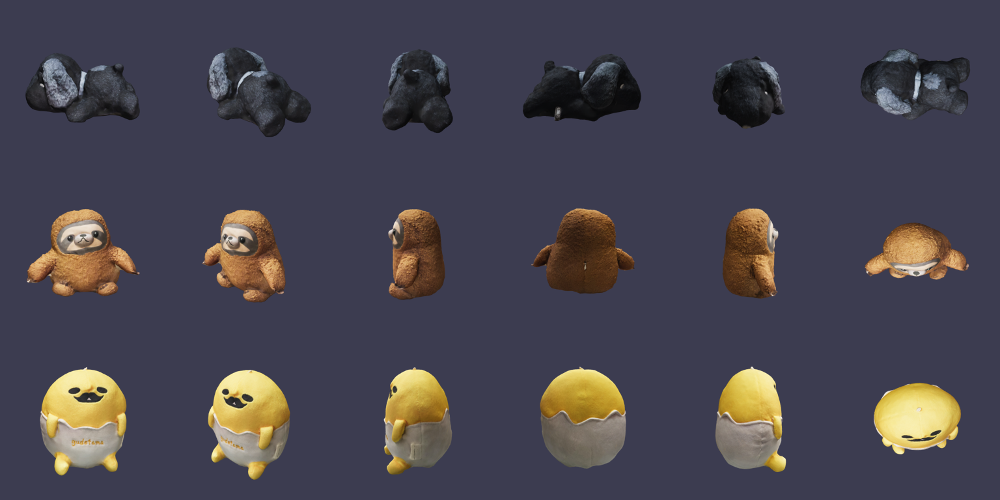
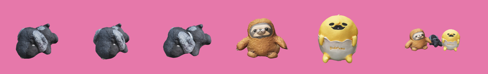

# 毛絨消消樂：目前進度報告

目標：做一款玩法和風格像 Candy Crush 的三消遊戲，畫面裡的方塊和圖案全部用這三個 AR 掃描的毛絨玩具。

這份報告整理到目前為止分析完的部分，方便在新的對話裡接著做。

---

## 1. 三個 AR 檔案分析結果

三個檔案都是 Apple **Object Capture** 掃出來的 USDZ。每個檔案裡面都是同樣的結構：

| 檔案 | 內容 | 建議代號 | 實際尺寸（寬×高×深） |
|---|---|---|---|
| `16f3fa10-AR-Code-Object-Capture-app-1786851926.usdz` | 黑色小狗（趴著，灰色垂耳，有項圈） | `dog` | 22 × 12 × 14 cm |
| `c14d1742-AR-Code-Object-Capture-app-1789054299.usdz` | 樹懶（咖啡色，坐姿） | `sloth` | 27 × 20 × 14 cm |
| `c47d4ae8-AR-Code-Object-Capture-app-1788967608.usdz` | 黃色蛋蛋（坐在蛋殼裡，衣服上寫 gudetama） | `egg` | 13 × 15 × 11 cm |

每個 USDZ 裡面有：

- `baked_mesh_xxxx.usdc`：網格，12,502 個點、25,000 個三角面，有法線，UV 是 faceVarying（有索引）
- `0/..._tex0.png`：顏色貼圖 2048×2048
- `0/..._norm0.png`：法線貼圖 2048×2048
- `0/..._ao0.png`：環境光遮蔽貼圖 2048×2048（灰階）
- Y 軸朝上，單位是公尺，模型底部已經在 y=0
- 材質：UsdPreviewSurface，roughness 0.9

角度預覽（每排一個，從左到右：正面、斜前 45°、右側、背面、左側、俯視）：



選定的遊戲方塊角度：



| 代號 | 相機水平角 yaw | 俯角 pitch | 曝光 | 備註 |
|---|---|---|---|---|
| dog | 300° | 25° | 1.7–2.0 | 黑色毛很暗，要提高曝光，再加一盞背光（rim）才看得出輪廓和臉 |
| sloth | 10° | 12° | 1.15 | 正面就很清楚 |
| egg | 10° | 12° | 1.05 | 正面就很清楚 |

另外試了一張三隻合照（打算當「彩色炸彈」特殊方塊）。目前小狗太小、構圖太鬆，要再調。

> 蛋蛋是蛋黃哥（Gudetama）的造型。自己玩沒問題，如果之後要公開或上架，要留意角色版權。

---

## 2. 已經驗證可行的轉檔流程

**USDZ → GLB → 透明背景 PNG（遊戲方塊圖）**

1. `tools/usd_to_glb.py`：用 `usd-core` 讀 USDZ，把 faceVarying UV 展開成每頂點 UV，貼圖縮到 1024 並轉 JPEG，用 `trimesh` 輸出 GLB。樹懶測試結果：約 13,800 頂點，**942 KB**（原檔 8.7 MB）。
2. `tools/render/render.html` + `shoot.mjs`：用 Playwright 開無頭瀏覽器，three.js 載入 GLB，打光（RoomEnvironment + 主光 + 可選背光），輸出透明背景 PNG。
3. `tools/inspect_usd.py`：印出 USD 檔的結構、點數、包圍盒（除錯用）。

### 在你電腦本地跑

需要：Python 3.10 以上、Node.js 18 以上。

```bash
# 0. 把三個 .usdz 放進 tools/source/，改名成 dog.usdz、sloth.usdz、egg.usdz
cd tools

# 1. Python 環境
python3 -m venv .venv
source .venv/bin/activate          # Windows: .venv\Scripts\activate
pip install -r requirements.txt

# 2. 轉成 GLB
mkdir -p out/models
python usd_to_glb.py source/dog.usdz   out/models/dog.glb
python usd_to_glb.py source/sloth.usdz out/models/sloth.glb
python usd_to_glb.py source/egg.usdz   out/models/egg.glb

# 3. 渲染方塊圖（開兩個終端機）
#    終端機 A（在 tools/ 目錄）：
python3 -m http.server 8765
#    終端機 B：
cd render
npm install
npx playwright install chromium
cd ..
node render/shoot.mjs render/jobs.example.json out/sprites
```

輸出在 `tools/out/sprites/`：`dog.png`、`sloth.png`、`egg.png`、`trio.png`。

要調角度、曝光，改 `render/jobs.example.json` 裡的 `yaw`、`pitch`、`exposure`、`rim` 再跑一次。

---

## 3. 遊戲設計規劃（還沒開始寫程式）

### 最重要的問題：只有 3 種方塊

Candy Crush 通常用 4–6 種顏色。只有 3 種的話，盤面隨便補一排就很容易自己連成三個，會一直連鎖消除，玩家的操作變得不重要。

打算的解法（保持只用這三隻）：

- **防連鎖補位**：新方塊掉下來時，大約 70–75% 的機率會挑「不會馬上湊成三連」的種類。Candy Crush 本身也會操控補位。這個機率可以每關調整，當作難度旋鈕。
- **靠特殊方塊和關卡目標拉出策略性**（見下面）。
- 每隻配一個鮮豔的底色，方便一眼辨認：小狗配淺藍、樹懶配薄荷綠、蛋蛋配粉紅。小狗是黑色，放深色盤面上會看不到，所以方塊圖要做成**白色描邊的貼紙風格**，再加柔和陰影。

如果試玩後覺得 3 種還是太容易，可以考慮每隻做兩種配色變成 6 種。這個要你決定。

### 基本規則

- 8×8 盤面（之後的關卡可以挖洞變形狀）
- 拖曳或點兩下交換相鄰方塊，沒湊成三連就換回來
- 消除後上面的方塊往下掉，從頂部補新的
- 沒有可走的步時自動洗牌；閒置約 5 秒提示一步

### 特殊方塊

| 怎麼做出來 | 特殊方塊 | 效果 |
|---|---|---|
| 一排 4 個 | 條紋方塊（方塊上蓋條紋） | 橫的消一整排，直的消一整列 |
| L 形或 T 形 | 包裝方塊（外面包一層糖果紙） | 炸掉周圍 3×3 |
| 一排 5 個 | 三隻合照球（彩色炸彈） | 跟哪一種交換，就消掉全盤那一種 |

兩個特殊方塊互換的組合技：

- 條紋 + 條紋 → 十字消除
- 條紋 + 包裝 → 3 排加 3 列
- 包裝 + 包裝 → 5×5 爆炸
- 彩色炸彈 + 條紋 → 全盤同種變條紋再一起發動
- 彩色炸彈 + 包裝 → 全盤同種變包裝再一起爆
- 彩色炸彈 + 彩色炸彈 → 清空全盤

### 計分與關卡

- 三連 60 分、四連 120、五連 200；連鎖每多一層，倍率 +1
- 關卡有步數限制，目標類型：達到分數、收集指定數量的某隻、清除果凍格
- 三顆星門檻；過關時剩下的步數變成條紋方塊自動發動（像 Sugar Crush 的收尾）
- 先做 10–15 關，用關卡地圖選關，進度存在瀏覽器 localStorage

### 畫面與音效

- 標題畫面：三隻在彈跳，「開始遊戲」、「3D / AR 看看」兩個按鈕
- 遊戲畫面：上方顯示剩餘步數、分數和星星進度條、關卡目標；下方是盤面
- 被選中的方塊會原地 3D 旋轉（預先渲染 24 格旋轉序列圖）
- 粒子特效、連鎖時跳出「好棒！」「太甜了！」之類的字
- 音效用 Web Audio 即時合成，不用另外準備音檔；有靜音鍵
- 介面用繁體中文

### 3D / AR 看看頁

- 用 Google 的 `<model-viewer>`（從 jsDelivr 載入，鎖定版本號）顯示三隻的 3D 模型，可以旋轉縮放
- iPhone 用 USDZ 開 AR Quick Look，Android 用 GLB 開 Scene Viewer
- 網頁用的 USDZ 也要縮小：貼圖降到 1024 重新打包（`usd-core` 的 `UsdUtils.CreateNewUsdzPackage`），預計每個約 1–2 MB

---

## 4. 預計的檔案結構

```
index.html              遊戲主頁（純 HTML/CSS/JS，Canvas 2D 畫盤面，不用打包工具）
style.css
game.js                 盤面邏輯、配對、掉落、特殊方塊、關卡
assets/sprites/         dog.png、sloth.png、egg.png、trio.png、各自的旋轉序列圖
assets/models/          dog.glb、sloth.glb、egg.glb（給 3D 檢視）
assets/models/          dog.usdz、sloth.usdz、egg.usdz（縮小版，給 iPhone AR）
tools/                  轉檔和渲染腳本（已完成）
```

本地測試遊戲：在專案根目錄跑 `python3 -m http.server 8000`，瀏覽器打開 `http://localhost:8000`。手機要測同一個 Wi-Fi 下用電腦的 IP 開。

---

## 5. 下一步

1. 本地跑完第 2 節的流程，確認三張方塊圖 OK
2. 寫一個 Python 後製腳本：方塊圖加白色描邊和陰影、輸出 256px；再渲染 24 格旋轉序列並拼成一張圖
3. 修三隻合照的構圖（小狗放大、靠近一點）
4. 寫遊戲本體：先做盤面邏輯（配對、掉落、防連鎖補位、洗牌），再加特殊方塊、關卡、畫面特效、音效
5. 做 3D / AR 看看頁，並打包縮小版 USDZ

---

## 6. 給新對話用的開場提示（直接複製貼上）

```
我在做一個像 Candy Crush 的三消網頁遊戲，方塊全部用我自己用 Object Capture 掃的三個毛絨玩具
（黑色小狗 dog、樹懶 sloth、黃色蛋蛋 egg）。請先讀專案裡的 REPORT.md，裡面有素材分析、
已經寫好的轉檔腳本（tools/）、和完整的遊戲設計規劃。

我已經在本地把三個 .usdz 放在 tools/source/，請從 REPORT.md 第 5 節「下一步」開始做。
遊戲用純 HTML/CSS/JS，不用打包工具，介面用繁體中文。
```
